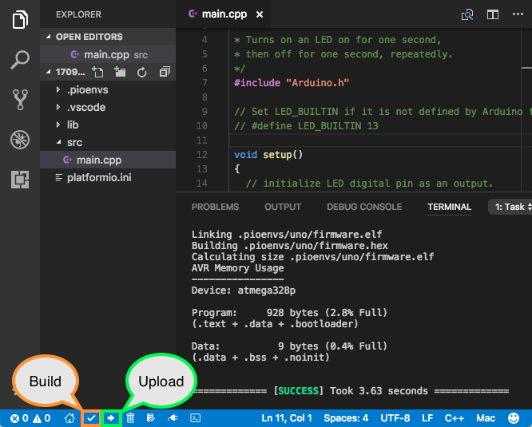

# Example Code

This example uses the Waveshare ESP32-S3-CAM-OVxxxx camera sample code from their GitHub repository:

- [Waveshare CameraWebServer Example](https://github.com/waveshareteam/ESP32-S3-CAM-OVxxxx/tree/main/examples/Arduino-v3.2.0/examples/02_CameraWebServer)

# Build Environment

## Visual Studio Code (VS Code)

Install [Microsoft Visual Studio Code](https://code.visualstudio.com/).

## PlatformIO Extension

Install the [PlatformIO extension](https://docs.platformio.org/en/latest/integration/ide/vscode.html) for VS Code.

PlatformIO allows you to build, upload, and monitor Arduino/ESP32 projects directly from a familiar IDE, such as Visual Studio Code.

The PlatformIO toolbar appears in the VS Code bottom toolbar and provides quick access to commonly used commands. Hover your mouse over any button to see its description.

### Build

1. Click the **Build** button on the PlatformIO toolbar to compile the project.
2. Wait for the build to complete. You should see a message similar to:

   `==== [SUCCESS] Took ??.?? seconds ====`

### Upload

1. Make sure the camera is disconnected from your laptop.
2. Press and hold the camera's **BOOT** button.
3. While holding the button, connect the camera to your laptop using a USB cable.
4. Once connected and you hear the connection tone, release the **BOOT** button.
5. Click the **Upload** button on the PlatformIO toolbar and wait for the process to finish.
6. You should see a success message similar to:

   `==== [SUCCESS] Took ??.?? seconds ====`

7. Disconnect the camera.

### Run and Monitor the Camera

1. Start the PlatformIO Serial Monitor by clicking the **plug icon pointing upward** on the toolbar.

   

2. Connect the camera to your laptop.
3. Watch the Serial Monitor for a message similar to:

   `Camera Ready! Use 'http://192.168.1.82' to connect`

   - Your IP address will likely be different.
   - If you miss the initial **Camera Ready!** message, the sample code periodically prints the IP address. Look for a message similar to:

     `192.168.1.82 Looping...6`

4. Open a web browser and navigate to the displayed IP address to access the camera.

   You can use your preferred browser or the VS Code integrated browser described below.

## VS Code Integrated Browser

VS Code includes an integrated browser that lets you open web pages in a tab within the IDE.

To open it:

1. Open the Command Palette:
   - **Windows/Linux:** `Ctrl+Shift+P`
   - **Mac:** `Cmd+Shift+P`
2. Type `Browser: Open Integrated Browser`.
3. Select the command and enter the camera's IP address in the browser's address bar.